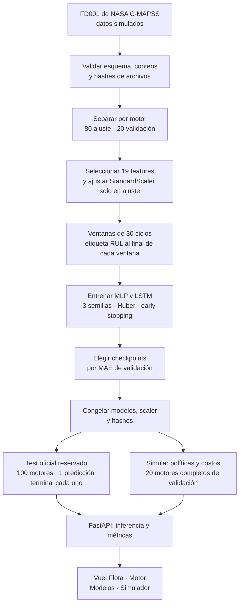

# PredictGuard — Guía de arranque, demostración y defensa técnica

Guía para la feria académica · 2 de noviembre de 2026

## 1. Problema, usuario objetivo y propuesta

**Problema.** Una política de mantenimiento por calendario interviene en un ciclo fijo, aunque dos motores puedan mostrar patrones de degradación diferentes. Una intervención temprana descarta vida útil; una tardía puede terminar en una falla. PredictGuard estudia si las mediciones de sensores permiten estimar la **vida útil restante** (*Remaining Useful Life*, RUL) y explorar decisiones de mantenimiento con costos explícitos.

**Usuario objetivo.** Un analista de confiabilidad o planificador de mantenimiento que necesita comparar motores, revisar señales, contrastar modelos y estudiar escenarios de intervención. Es una **persona de uso propuesta** para el prototipo: los datos son simulados y no hay evidencia de adopción por una aerolínea.

**Propuesta de valor.** La aplicación reúne en una sola interfaz las predicciones de dos modelos, sus métricas de evaluación y un simulador de costos. Permite explicar qué se gana y qué se arriesga al pasar de una regla fija a una política basada en RUL predicho. Es un prototipo académico, **no una instrucción de mantenimiento aeronáutico real**.

## 2. Cómo arrancar la aplicación

### Requisitos

- Windows con Docker Desktop iniciado y el motor de contenedores funcionando.
- Repositorio completo de PredictGuard, incluidos `data/raw/` y los artefactos versionados en `artifacts/`.
- Puertos `8080` (web) y `8000` (API) disponibles. La primera construcción necesita descargar dependencias y puede tardar varios minutos.

Desde PowerShell, en la carpeta del repositorio:

```powershell
cd 'C:\Users\sebas\OneDrive\Escritorio\Github\Deep learning\deep_learning_proyecto_final'
docker compose up --build -d
docker compose ps
```

Cuando ambos servicios aparezcan como **healthy**, abrir:

| Recurso | Dirección |
|---|---|
| Aplicación | <http://localhost:8080> |
| Documentación interactiva de la API | <http://localhost:8000/docs> |
| Estado de la API | <http://localhost:8000/health> |

Para ver mensajes de diagnóstico: `docker compose logs -f`. Para detener la aplicación iniciada por ese mismo proyecto: `docker compose down`. Si la aplicación ya está abierta, basta con visitar la dirección web; no hay que volver a entrenar ni abrir Kaggle. Si `docker compose` informa que un puerto está ocupado, comprobar qué contenedores están funcionando con `docker ps` antes de iniciar otra instancia. Los puertos se pueden cambiar mediante `PREDICTGUARD_WEB_PORT` y `PREDICTGUARD_API_PORT` en un archivo `.env` basado en `.env.example`.

## 3. Qué contiene la aplicación

| Sección | Qué permite hacer | Qué conviene explicar |
|---|---|---|
| **Flota** | Revisar los 100 motores de demostración, último ciclo observado, RUL predicho por MLP y LSTM, búsqueda e indicador configurable por umbral. | El indicador es una regla de visualización sobre predicciones, no una orden real de intervención. |
| **Motor** | Seleccionar un motor, ver la trayectoria observada de un sensor y comparar las dos predicciones en su último ciclo. | El test oficial solo aporta una etiqueta real para la observación terminal; no se inventa RUL real para el historial mostrado. |
| **Modelos** | Consultar MAE, RMSE, NASA Score, sesgo, versiones y curvas de evaluación/entrenamiento. | Son resultados congelados. Una cifra menor es mejor para MAE, RMSE y Score, pero hay incertidumbre entre motores. |
| **Simulador** | Cambiar costos, margen de acción y umbrales; comparar calendario, MLP y LSTM en costo medio por motor. | Usa los 20 motores completos de **validación** y quetzales hipotéticos; no mide ahorros reales de una empresa. |

La web usa Vue 3 y Nginx. Nginx envía las solicitudes `/api/` a FastAPI. La API carga al arrancar los modelos MLP/LSTM, el escalador y los metadatos; el navegador no recibe los checkpoints.

## 4. Demostración sugerida (3–5 minutos)

1. **Presentar el problema (20–30 s).** “Con una edad fija se puede intervenir demasiado pronto o demasiado tarde. Queremos estimar RUL en ciclos y comparar decisiones bajo supuestos de costo”. Aclarar que FD001 simula motores turbofán.
2. **Abrir Flota (30–45 s).** Mostrar los 100 motores y cambiar el umbral de 15 a otro valor para enseñar cómo cambia el indicador. Aclarar que el umbral de esta vista es solo visual.
3. **Seleccionar un motor (45–60 s).** Usar “Ver motor” en un motor de la lista, por ejemplo el **#034**. Mostrar sus ciclos observados, la curva de `sensor_11` y las predicciones de MLP/LSTM. Señalar que el número predicho es **ciclos restantes**, no horas ni fecha de falla.
4. **Abrir Modelos (45–60 s).** Comparar MAE de test: MLP **16.09** ciclos y LSTM **14.70**. Explicar que la LSTM tuvo menor error observado en test, pero que el intervalo bootstrap de la diferencia incluye cero; no se demuestra superioridad robusta.
5. **Abrir Simulador (60–75 s).** Mostrar el escenario base: calendario **Q17,850**, MLP **Q11,491.60**, LSTM **Q11,333.06** por motor. Cambiar “Vida descartada” de **Q100 a Q200 por ciclo** y pulsar “Calcular costos” para que se vean resultados distintos. Indicar que son escenarios hipotéticos calculados en validación.
6. **Cerrar (20 s).** “El aporte es conectar predicción, incertidumbre y decisión económica en una interfaz. El siguiente paso para uso real sería validar con datos operativos y costos reales”.

**Plan de contingencia:** si la interfaz no abre, comprobar `docker compose ps` y `/health`; la pestaña `/docs` permite mostrar la API, y los resultados congelados permanecen en `docs/results_phases_7_10.md` y `artifacts/metrics/test_metrics.json`.

## 5. Diagrama del pipeline



**Detalles que todo integrante debe poder explicar:**

- FD001 contiene 100 motores de desarrollo y 100 motores de test. La división de desarrollo se hizo **por `unit_id` completo**, no por ventanas, para impedir que ciclos del mismo motor aparezcan a ambos lados de ajuste/validación.
- Hay **19 entradas ordenadas**: `cycle`, tres condiciones operativas y 15 sensores. Se excluyeron seis sensores constantes según la varianza de los motores de ajuste. `unit_id` identifica la consulta, **no entra al modelo**.
- `StandardScaler` se ajustó exclusivamente con las filas de los 80 motores de ajuste. El mismo escalador se aplica a validación, test y API.
- Cada ventana tiene **30 ciclos**. El MLP la aplana y usa capas densas 128/64; la LSTM procesa la secuencia con dos capas recurrentes de 64 unidades. Ambos usan los mismos datos, pérdida Huber y tres semillas (42, 43, 44).
- En desarrollo, `RUL = último ciclo del motor − ciclo de la observación final de la ventana`. El test oficial tiene una etiqueta de RUL por motor **solo al final de la trayectoria observada**. Por eso el test sirve para evaluación terminal, mientras que la simulación ciclo a ciclo usa validación completa.
- La selección de modelos e hiperparámetros ocurrió en validación. Los modelos se congelaron antes de consultar el test oficial; el test no eligió umbrales ni checkpoints.

## 6. Métricas obtenidas y cómo interpretarlas

### Predicción de RUL

| Métrica | MLP | LSTM | Lectura correcta |
|---|---:|---:|---|
| Mejor MAE de validación | 16.99 ciclos | 18.13 ciclos | MLP fue mejor en el conjunto usado para selección. |
| MAE de test oficial | 16.09 ciclos | 14.70 ciclos | Error absoluto medio en 100 observaciones terminales; menor es mejor. |
| RMSE de test | 24.07 ciclos | 20.74 ciclos | Da más peso a errores grandes. |
| NASA PHM08 Score, suma | 30,837.07 | 1,814.59 | Penaliza más la sobreestimación; menor es mejor. La suma corresponde a 100 motores. |
| Sesgo medio (predicho − real) | +7.31 ciclos | +6.46 ciclos | Ambos modelos tienden a **sobreestimar** la vida restante. |

La reducción observada de MAE de LSTM respecto al MLP en test fue **8.6 %**, por debajo de la meta aspiracional del 10 %. El intervalo bootstrap pareado del 95 % para `MAE_LSTM − MAE_MLP` fue **−4.85 a +1.67 ciclos**. Como incluye cero, se debe decir “la LSTM obtuvo menor MAE en esta muestra”, no “la LSTM es definitivamente superior”. El bootstrap remuestreó **motores**, porque las ventanas de un mismo motor están correlacionadas.

**Definiciones breves:** MAE es el promedio de `|RUL_predicho − RUL_real|`; RMSE es la raíz del promedio de los errores al cuadrado. El sesgo conserva el signo. El Score NASA es asimétrico: una predicción demasiado alta recibe más penalización que una demasiado baja de la misma magnitud. La sobreestimación es especialmente delicada si se usa para decidir cuándo intervenir.

### Escenario económico base

| Política | Umbral | Costo medio hipotético | Ahorro simulado frente a calendario |
|---|---:|---:|---:|
| Calendario | Edad 125 ciclos | Q17,850.00/motor | 0 % |
| MLP | RUL predicho 15 ciclos | Q11,491.60/motor | 35.62 % |
| LSTM | RUL predicho 15 ciclos | Q11,333.06/motor | 36.51 % |

Supuestos base: intervención **Q10,000**, falla **Q50,000**, ciclo de vida descartada **Q100**, margen mínimo de acción **5 ciclos** e inferencia hipotética de **Q0.01** (MLP) o **Q0.05** (LSTM). Las tres políticas elegidas registraron cero fallas entre los 20 motores de validación. Los umbrales se eligieron y evaluaron en esos mismos motores: los ahorros son **exploratorios y potencialmente optimistas**, no una promesa de ahorro operativo. El test oficial no se usó para esta simulación.

### Aplicación y pruebas

La suite completa aprobó **39 pruebas**. La verificación local de 100 solicitudes secuenciales `POST /compare` dio p95 aproximado de **56 ms** a través de Nginx y Docker Compose, en CPU Windows 11 Intel Family 6 Model 165; la meta del proyecto es menor que 2 s. Esta medida incluye el recorrido HTTP local y ambos modelos, pero **no** prueba concurrencia ni rendimiento en producción. Se comprobó el flujo completo en el navegador y los dos contenedores iniciaron sanos.

## 7. Preguntas probables del catedrático

| Pregunta | Respuesta que debe poder dar cualquier integrante |
|---|---|
| ¿Qué problema resuelve y para quién? | Ayuda a un analista de confiabilidad a explorar mantenimiento basado en RUL predicho frente a una edad fija. El valor demostrado es analítico y educativo; no hay despliegue real. |
| ¿Qué tiene de creativo más allá de un chat? | Integra señales temporales, dos modelos, comparación de errores y un simulador de decisiones con costos. El usuario cambia supuestos y ve su efecto. |
| ¿De dónde vienen los datos? | De NASA C-MAPSS FD001, un conjunto **simulado** de degradación de motores turbofán: 100 motores para desarrollo y 100 de test. |
| ¿Qué predice exactamente el modelo? | RUL en **ciclos** para la observación final de una ventana de 30 ciclos; no predice una fecha ni certifica una falla física. |
| ¿Cómo evitaron fuga de información? | Se dividieron motores completos antes de crear ventanas; el escalador se ajustó solo con los 80 motores de ajuste; test se reservó hasta congelar la selección. |
| ¿Por qué comparar MLP y LSTM? | El MLP sirve como referencia profunda al aplanar la ventana; la LSTM procesa su orden temporal. Comparten entrada, partición, pérdida y semillas para una comparación controlada. |
| ¿Cómo se entrenaron? | En Kaggle, con semillas 42/43/44, Adam, pérdida Huber, batch 64 y early stopping según MAE de validación. Para la demo se cargan checkpoints; no se entrena al abrir la web. |
| ¿Qué significa MAE 14.70? | En las 100 observaciones terminales de test, la diferencia absoluta media entre RUL predicho por LSTM y RUL real fue 14.70 ciclos. No significa que cada motor falle dentro de ±14.70 ciclos. |
| ¿La LSTM ganó? | En test su MAE observado fue menor (14.70 frente a 16.09), pero en validación el MLP fue mejor (16.99 frente a 18.13). El intervalo bootstrap de la diferencia incluye cero; no afirmamos superioridad robusta. |
| ¿Por qué importa el sesgo positivo? | Indica sobreestimación media de RUL: el modelo puede sugerir más vida de la real. En una política de intervención, eso merece atención especial. |
| ¿Qué hace el NASA Score? | Penaliza errores de RUL de forma asimétrica, especialmente sobreestimaciones. Su suma solo se compara justamente si se evaluó el mismo número de casos; aquí ambos modelos usan los mismos 100 motores. |
| ¿Por qué no usan el test para simular mantenimiento ciclo a ciclo? | El test está truncado y solo tiene RUL real para el último ciclo observado. La simulación requiere trayectorias completas; por eso usa los 20 motores de validación. |
| ¿De dónde salen los costos y los ahorros? | Son supuestos hipotéticos en quetzales, no tarifas de NASA ni resultados de una empresa. El simulador aplica la misma regla y los mismos motores a las tres políticas. |
| ¿Es válido afirmar que ahorra 36.51 %? | Solo como estimación **dentro del escenario simulado de validación**. Umbral y evaluación económica usan los mismos motores, así que puede ser optimista. No es ahorro real demostrado. |
| ¿Cómo responde la aplicación a una entrada inesperada? | La API valida modelo, motor, ciclo, longitud y columnas de la ventana; rechaza entradas inválidas con errores 4xx. Los modelos y el escalador se cargan una vez al iniciar. |
| ¿Qué rendimiento observaron? | En la prueba local secuencial por Docker, p95 de `POST /compare` fue aproximadamente 56 ms en CPU, por debajo de la meta de 2 s. Falta probar carga concurrente para un entorno público. |
| ¿Cuáles son los límites principales? | Datos simulados FD001, un modo de degradación, test terminal, posibles errores grandes de sobreestimación y costos supuestos. El prototipo no se usa para decisiones aeronáuticas reales. |

## 8. Mapa rápido de los criterios de la feria

| Criterio | Evidencia que conviene mostrar |
|---|---|
| **Creatividad** | Comparación MLP/LSTM conectada a un simulador económico interactivo, más allá de responder preguntas en texto. |
| **Utilidad** | Escenario del analista: priorizar revisión de motores y estudiar el costo de intervenir temprano o tarde. Distinguir valor potencial de validación operativa pendiente. |
| **Utilizabilidad** | Recorrido de cuatro vistas, búsqueda de motor, umbral visible, mensajes de error, respuesta local p95 ≈56 ms y servicios con estado de salud. |
| **Dominio técnico** | Poder explicar división por motor, escalado sin fuga, ventanas, etiquetas, entrenamiento, selección, test reservado, métricas, incertidumbre y simulación económica. |

## 9. Archivos de respaldo para estudiar

- `docs/preprocessing_report.md`: particiones, features, escalador y ventanas.
- `docs/experimental_protocol.md`: entrenamiento, métricas y reglas de evaluación.
- `docs/results_phases_7_10.md`: resultados e interpretación de modelos y costos.
- `docs/business_assumptions.md`: reglas y límites del simulador.
- `docs/deployment.md` y `docs/architecture.md`: arranque, API y arquitectura.
- `artifacts/metrics/test_metrics.json` y `artifacts/business/summary.json`: cifras finales sin redondeo.

