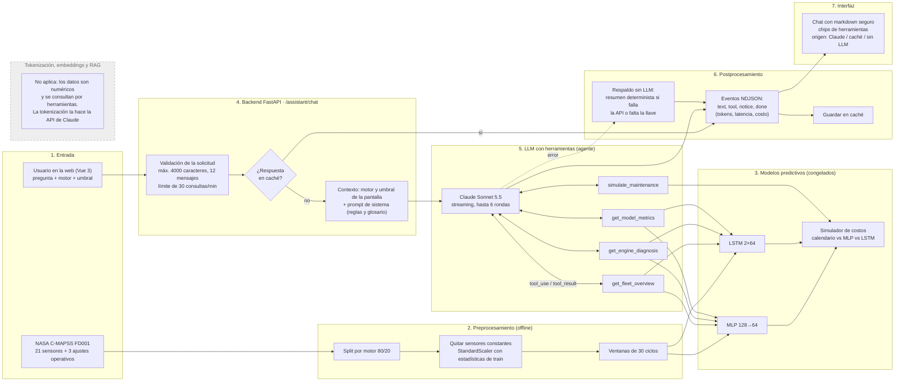

# Arquitectura de PredictGuard

PredictGuard combina dos capas: modelos predictivos entrenados (MLP y LSTM) que
estiman la vida útil restante (RUL, en ciclos) de motores turbofan simulados, y
un **asistente de mantenimiento con LLM** (Claude) que consulta esos modelos
mediante herramientas y explica los resultados en lenguaje natural.

## Pipeline completo

## Componentes

| Etapa | Implementación |
|---|---|
| Interfaz | Vue 3 + Vite, servida por Nginx (`frontend/`). Pestañas Flota, Motor, Modelos, Simulador y Asistente. |
| Backend | FastAPI (`api/main.py`). Endpoints de predicción, comparación, simulación y evaluación, más `/assistant/chat` y `/assistant/status`. |
| Modelos | MLP y LSTM congelados; la API verifica los hashes de `selected.json` antes de cargarlos. |
| Asistente | `api/assistant.py`: prompt de sistema, cuatro herramientas de solo lectura, bucle de herramientas, caché y respaldo. |
| Evaluación del LLM | `scripts/eval_assistant.py` y `docs/assistant_evaluation.md` (agente vs. baseline sin herramientas). |

## Decisiones de diseño

- **El LLM no predice.** Cada cifra que muestra sale de una herramienta que lee
  los modelos congelados, el simulador o las métricas de test. El prompt le
  prohíbe inventar números.
- **Herramientas de solo lectura.** Reciben parámetros acotados (enteros y
  costos validados por `SimulationRequest`), por lo que una instrucción
  maliciosa en la pregunta no puede modificar datos ni ejecutar acciones.
- **Sin RAG.** El asistente consulta datos estructurados mediante herramientas;
  no hay corpus de documentos que recuperar, por eso no hay embeddings, chunking
  ni base vectorial.
- **Resiliencia.** Caché de respuestas en memoria, reintentos del SDK y un
  resumen determinista, claramente marcado como "sin LLM", cuando no hay
  conexión o llave.
- **Observabilidad.** Cada respuesta registra tokens, llamadas a la API,
  latencia y costo estimado (evento `done` y logs de la API).
- **Parámetros de generación.** `max_tokens=1500`. `temperature` y `top_p` no
  se fijan porque Sonnet 5.5 rechaza valores distintos del predeterminado.

## Datos y carga

La API verifica los hashes de `selected.json` antes de cargar los checkpoints.
El escalador y el orden de features se comparan con el manifiesto. Los datos de
test sirven para mostrar motores y predecir su RUL terminal; el simulador usa
predicciones de validación de motores completos. Nginx distribuye la interfaz y
redirige `/api/` al backend (con el almacenamiento en búfer desactivado para
`/api/assistant/` para permitir el streaming). El backend carga todos los
recursos una vez al arrancar y los conserva en memoria para las solicitudes.

## Configuración del asistente

La llave se lee de `ANTHROPIC_API_KEY` (variable de entorno o `.env`, que no se
sube a git) y el modelo de `ANTHROPIC_MODEL`. `docker-compose.yml` pasa ambas al
contenedor de la API.
