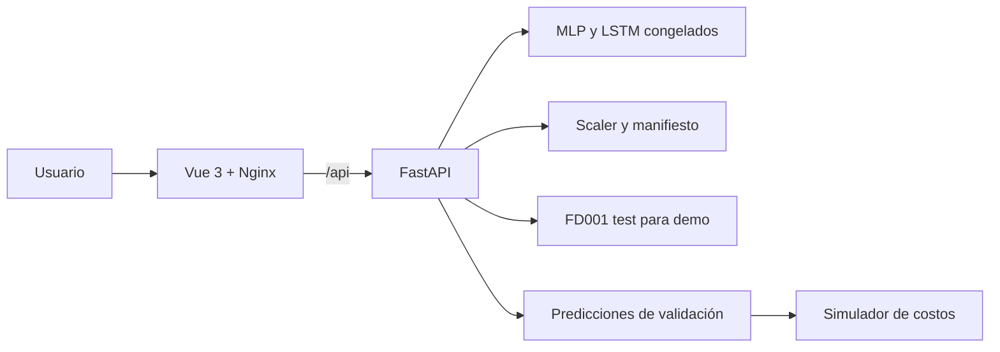

# Arquitectura de PredictGuard

La API verifica los hashes de `selected.json` antes de cargar los checkpoints.
El escalador y el orden de features se comparan con el manifiesto. Los datos de
test sirven para mostrar motores y predecir su RUL terminal; el simulador usa
predicciones de validación de motores completos. Nginx distribuye la interfaz
y redirige `/api/` al backend. El backend carga todos los recursos una vez al
arrancar y los conserva en memoria para las solicitudes.
